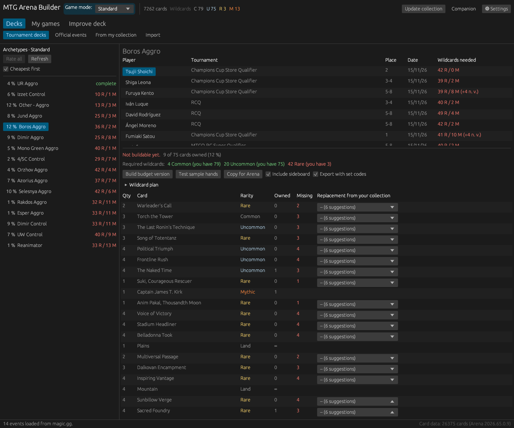
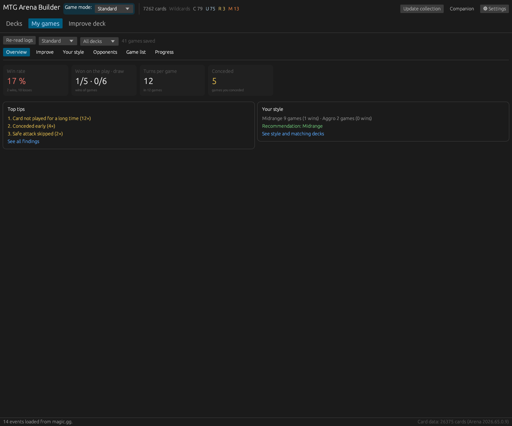
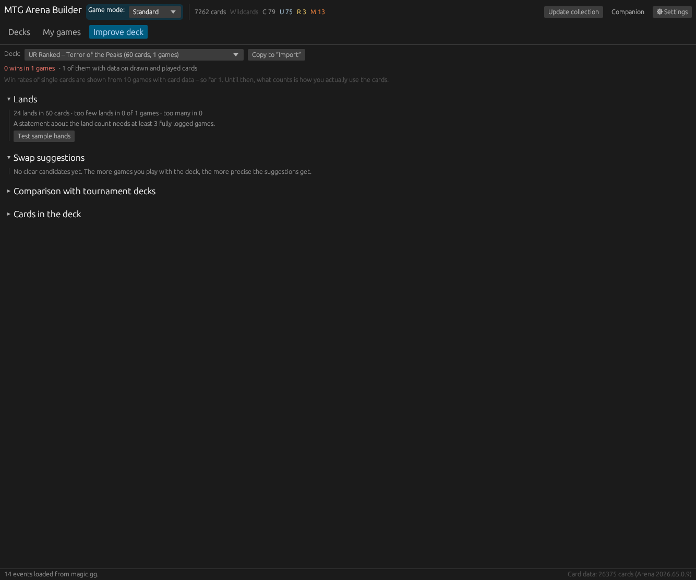
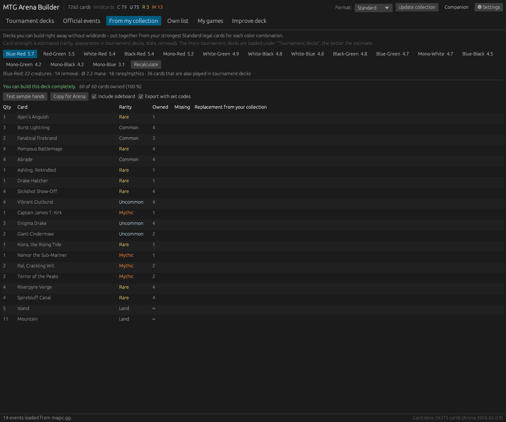
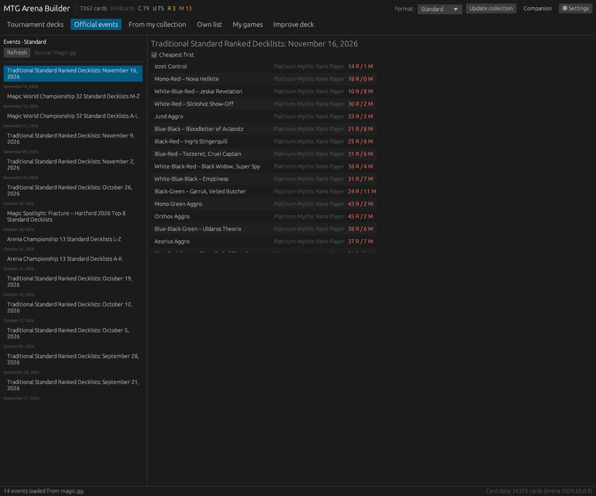

# MTG Arena Builder

[](https://github.com/Daedaleus/mtg_arena_builder/actions/workflows/ci.yml)
[](https://github.com/Daedaleus/mtg_arena_builder/actions/workflows/audit.yml)
[](https://github.com/Daedaleus/mtg_arena_builder/releases/latest)
[](LICENSE)

A desktop companion for **Magic: The Gathering Arena** players who would
rather not build decks themselves. It compares current tournament decks with
your own collection, builds decks from the cards you own, analyses your games
and gives hints during a match in a small companion window.

The interface is available in **English and German** (follows the operating
system, changeable under *Settings*); card names and card images use the same
language.

> Day-to-day use is on Windows. Linux and macOS builds are compiled and tested
> in CI but have not been tried in real use yet.



## Features

| Tab | What it does |
|---|---|
| **Tournament decks** | Archetypes and decklists from MTGTop8 per format. Shows what your collection is missing and whether your wildcards are enough; replacement cards from your collection, *Build budget version*, a **wildcard plan** (what you can craft now and in which order the rest follows), **sample hands** and export for the Arena import. |
| **Official events** | Decklists from magic.gg: World Championship, Arena Championship, Regional Championships and the weekly ranked decks. Archetypes are recognised from the MTGTop8 lists. |
| **From my collection** | Builds 60-card decks per colour or colour pair using only cards you own (mana curve, creatures, removal, matching lands). |
| **Own list** | Paste any decklist and check it against your collection. |
| **My games** | Analysis of the Arena log: typical mistakes with examples ("land not played", "better play available", "safe attack skipped" …), your **play style** with matching tournament decks, opponent analysis, a game list and **progress** (constructed and limited rank, win rate per deck). |
| **Improve deck** | Card usage per deck, land check, sample hands, comparison with the matching tournament archetype and swap suggestions. |

<table>
  <tr>
    <td></td>
    <td></td>
  </tr>
  <tr>
    <td align="center"><em>My games</em> – play style and what to improve</td>
    <td align="center"><em>Improve deck</em> – how you use each card</td>
  </tr>
  <tr>
    <td></td>
    <td></td>
  </tr>
  <tr>
    <td align="center"><em>From my collection</em> – decks from cards you own</td>
    <td align="center"><em>Official events</em> – decklists from magic.gg</td>
  </tr>
</table>

**Sample hands** play a deck 1000 times up to turn 6 (mulligan, land drops,
spells following the turn suggestion) against a fast opponent and show how
often lands or colours are missing, how much mana is used and who is ahead
after turn 6. With enough recorded games you also get a personal comparison
up to turn 10 against *your* real opponents – once with the suggested plays
and once the way you actually play.

**Companion window** (switch on at the top right) follows the Arena log live:
mulligan advice, turn suggestion (land and spells with colour check), safe
attacks, lethal damage, block suggestions and warnings about likely combat
tricks. It never acts in the game.

## Download

Get the latest version from the
[releases page](https://github.com/Daedaleus/mtg_arena_builder/releases/latest).
It is a single executable – no installation needed.

Every release file is built by GitHub Actions from the tagged commit, scanned
for malware (ClamAV, plus Microsoft Defender for Windows) and comes with a
SHA-256 checksum and a signed
[build provenance attestation](https://docs.github.com/actions/security-guides/using-artifact-attestations-to-establish-provenance-for-builds):

```powershell
gh attestation verify mtg_arena_builder-windows-x64.exe --repo Daedaleus/mtg_arena_builder
```

The executable is not code-signed, so Windows SmartScreen may warn on the
first start (*More info* > *Run anyway*).

## Requirements

- MTG Arena with **Account > "Detailed Logs (Plugin Support)"** enabled in
  the Arena options (restart Arena afterwards).
- To read your collection, Arena must be running (main menu). Windows asks
  for administrator rights for this step – see [Privacy and safety](#privacy-and-safety).

## Building from source

Requires Rust (edition 2024) and, on Windows, the MSVC build tools.

```powershell
cargo run --release
```

On Windows, `.\build.ps1` runs all checks, builds the release version into
`dist\` and creates a desktop shortcut. Tests, coverage, the diagnostic
command line and the release process are described in
[CONTRIBUTING.md](CONTRIBUTING.md).

## Privacy and safety

- **Collection:** read *read-only* from Arena's memory via
  [mtga-reader](https://github.com/mtgatool/mtga-reader), like other Arena
  trackers do. This is the only step that needs administrator rights. Arena
  itself is never modified. Use at your own risk.
- **Games and rank:** read from Arena's `Player.log`.
- **Card data:** Arena's local card database (`Raw_CardDatabase_*.mtga`).
- **Network:** only public pages are fetched – [MTGTop8](https://www.mtgtop8.com)
  (at most one request every 5 s), [magic.gg](https://magic.gg/decklists) and
  [Scryfall](https://scryfall.com) – and everything is cached. Nothing about
  you or your games is sent anywhere.
- **Your data** stays on your computer in `%APPDATA%\mtg_arena_builder\data`
  (Linux/macOS: the corresponding data directory): settings, the last read
  collection, all analysed games and the cache.

## Contributing

Bug reports and ideas are welcome as
[issues](https://github.com/Daedaleus/mtg_arena_builder/issues). For code
changes see [CONTRIBUTING.md](CONTRIBUTING.md); security problems please
report as described in [SECURITY.md](SECURITY.md). Planned work and ideas
are tracked as [issues](https://github.com/Daedaleus/mtg_arena_builder/issues)
too.

## License

[GPL-3.0-or-later](LICENSE) (required by mtga-reader).

MTG Arena Builder is unofficial Fan Content permitted under the
[Fan Content Policy](https://company.wizards.com/en/legal/fancontentpolicy).
Not approved/endorsed by Wizards. Portions of the materials used are property
of Wizards of the Coast. ©Wizards of the Coast LLC.
